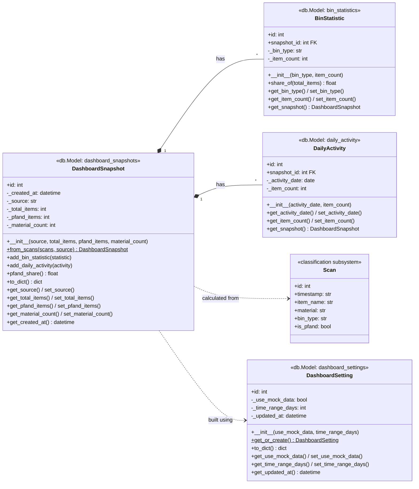
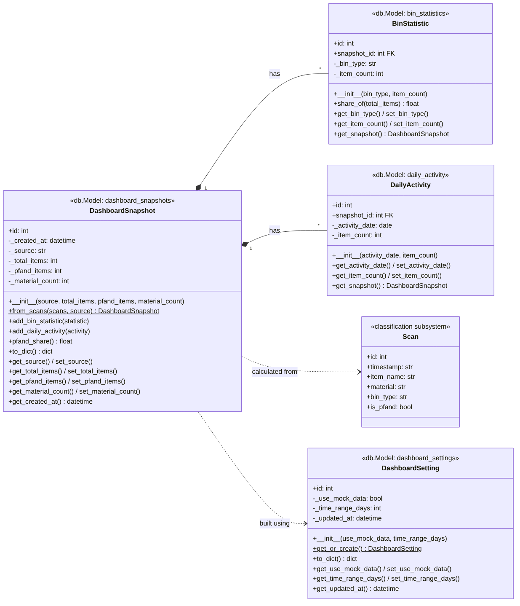

# Class Diagrams
## 1. User Management Subsystem (Sejal Dolas)  
This module handles user creation and profile settings.

* **User creation:** Basic user creation and account setup.
* **Country selection upon set up** Must implement a minimum of 3 unique database entities.
* **Login:** User login and authentication after account creation.
* **View country specific rules:** Access a repository of local recycling rules based on selected country.

## 2. Waste Classification Subsystem (Swarbhanu Bandyopadhaya)  

This module handles the core computer vision and identification features.

* **Geographic Scope:** Provides basic waste classification supporting a maximum of 2 countries.
* *Implemented:* Germany (`rules.json`). The rules file is per country, so adding a second country is a configuration change, not a code change.
* **Data Persistence:** Every single item scanned must be saved to the database. 
  * *Example:* If a user scans 2 plastic bottles, it must create 2 separate entries in the database.

## 3. Educational Chatbot (Bhavisha Ah-Moo)  
This module provides conversational AI assistance for local recycling rules.

* **Core Functionality:** Basic Q&A capabilities focusing on waste disposal rules for 2 countries.
* **Session Handling:** Must include active chat session management.
* **Database Integration:** Must connect to the database to:
  * Fetch local recycling rules to feed as context to the chatbot.
  * Fetch the active user's selected country.
  * Fetch count of number of items scanned of a specific type of material.

## 4. Analytics Dashboard (Srivaishnavi Jakku)  
This module provides statistical insights based on classification data.

* **User Statistics:** Basic stats displaying the volume of items scanned per category for individual users. 
  * *Example:* "40% plastic scanned during the last week."
* **Government Statistics:** Basic statistical views tailored specifically for government officials and municipalities.
* **Database Integration:** Must connect to the database to fetch and filter information dynamically by selected fields.

---

## Statistical Dashboard (Srivaishnavi Jakku)

The Statistical Dashboard reads the classification results stored by the classification subsystem (the `scans` table), calculates statistics, and shows them on a web dashboard: summary cards (items classified, Pfand items, materials detected), an items-by-bin chart, and an activity-over-time chart. Each refresh is stored in the database as a snapshot.

Models: `app/models/dashboard.py` · Logic: `app/subsystems/dashboard/services.py` · Routes: `app/subsystems/dashboard/routes.py` · Page: `templates/dashboard/dashboard.html` · URL: http://localhost:8000/dashboard/

| Class (table) | Responsibility |
|---|---|
| `DashboardSetting` (`dashboard_settings`) | Where the dashboard gets its data: mock data or live scans, and how many days back. |
| `DashboardSnapshot` (`dashboard_snapshots`) | The statistics at one point in time: total items, Pfand items, number of materials. Built from scans with `from_scans()`. |
| `BinStatistic` (`bin_statistics`) | Items per bin type (e.g. Gelbe Tonne) in a snapshot, for the doughnut chart. |
| `DailyActivity` (`daily_activity`) | Items per day in a snapshot, for the line chart. |

All four are SQLAlchemy models (`db.Model` with `db.Column`), so `db.create_all()` creates their tables. Each has a constructor (`__init__`), initialization methods (`get_or_create`, `from_scans`, `add_bin_statistic`, `add_daily_activity`), and getters/setters that validate values before they are saved. A snapshot owns its `BinStatistic` and `DailyActivity` rows (one-to-many, deleted together).

Until the classifier has produced real scans, the dashboard uses mock scans generated with the classification subsystem's own bin rules (`rules.json`). Switch to live data with `POST /dashboard/api/settings` and `{"use_mock_data": false}`.

Run the tests: `docker compose exec web python -m pytest app/subsystems/dashboard/tests`

### Video

Video presentation: [Video HTA1](https://fhdoprod-my.sharepoint.com/:v:/r/personal/bhavisha_ah-moo001_stud_fh-dortmund_de/Documents/MDTSem1/CPC/Capstone/HomeTaskAssignment%20Videos/Group3_HomeTaskAssignment1.mp4?d=wd3aec5dd936c4e9a9eceb3ea7e8f70a9&csf=1&web=1&nav=eyJyZWZlcnJhbEluZm8iOnsicmVmZXJyYWxBcHAiOiJPbmVEcml2ZUZvckJ1c2luZXNzIiwicmVmZXJyYWxBcHBQbGF0Zm9ybSI6IldlYiIsInJlZmVycmFsTW9kZSI6InZpZXciLCJyZWZlcnJhbFZpZXciOiJNeUZpbGVzTGlua0NvcHkifX0&e=zaWQr1) (access only with an FH-Dortmund account)
