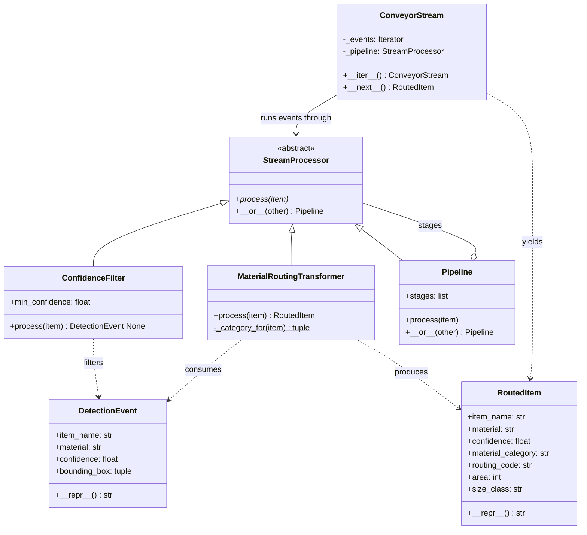

## Waste Classification (Swarbhanu Bandyopadhaya)

Optical sorters on the conveyor belt emit a continuous stream of image-recognition payloads. The classification pipeline discards low-confidence predictions, then turns the visual tags and bounding box metrics of everything that survives into a material category (PET, HDPE, Aluminium, ...) and a conveyor routing code (`R-01`, `R-03`, ...) that tells the sorter which lane to divert the item to.

Code: `app/subsystems/classification/stream.py` · Tests: `app/subsystems/classification/tests/test_stream.py` (24 tests)

| OOP concept | Where |
|---|---|
| Abstract Base Classes | `StreamProcessor` declares `process()` with `@abstractmethod`; the class cannot be instantiated |
| Inheritance & polymorphism | `ConfidenceFilter` and `MaterialRoutingTransformer` both inherit `StreamProcessor` and are called through the same `process()`, without the pipeline knowing which it holds |
| Operator overloading | `__or__`: `ConfidenceFilter(0.7) \| MaterialRoutingTransformer()` builds a `Pipeline`. `Pipeline` overrides `__or__` so chains stay flat instead of nesting |
| Iterators & generators | `ConveyorStream` implements `__iter__`/`__next__` and skips items the pipeline dropped; `synthetic_detection_stream()` is a generator |

```python
pipeline = ConfidenceFilter(0.7) | MaterialRoutingTransformer()

for item in ConveyorStream(synthetic_detection_stream(count=200, seed=42), pipeline):
    print(item.material_category, item.routing_code)   # only items that passed every stage
```



### Video

Video presentation: [Video HTA2](https://fhdoprod-my.sharepoint.com/:v:/r/personal/bhavisha_ah-moo001_stud_fh-dortmund_de/Documents/MDTSem1/CPC/Capstone/HomeTaskAssignment%20Videos/Group3_HomeTaskAssignment2.mp4?d=w5af3f756afcc456185820c3f00a66ad2&csf=1&web=1&nav=eyJyZWZlcnJhbEluZm8iOnsicmVmZXJyYWxBcHAiOiJPbmVEcml2ZUZvckJ1c2luZXNzIiwicmVmZXJyYWxBcHBQbGF0Zm9ybSI6IldlYiIsInJlZmVycmFsTW9kZSI6InZpZXciLCJyZWZlcnJhbFZpZXciOiJNeUZpbGVzTGlua0NvcHkifX0&e=xhRyno)
