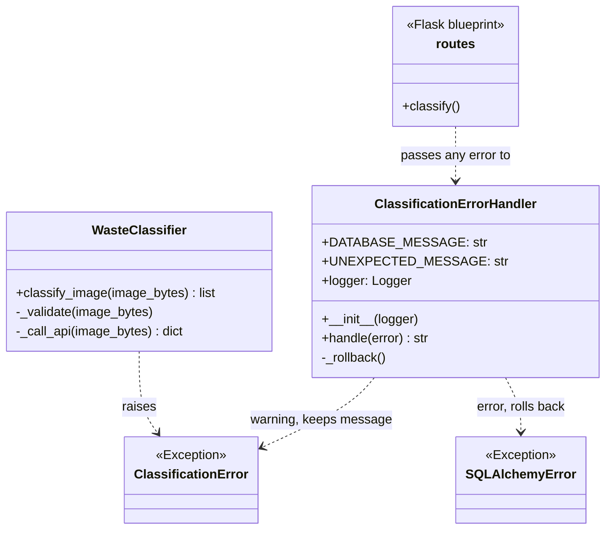

# Home Assignment 4: Exception Handling and Unit Tests 

## Video

Video presentation: [Video HTA4](https://fhdoprod-my.sharepoint.com/:v:/g/personal/bhavisha_ah-moo001_stud_fh-dortmund_de/IQDA8MnjKNeJSrsNb25xY20kAXG93LjWu2JPMqxCra-rMcU?nav=eyJyZWZlcnJhbEluZm8iOnsicmVmZXJyYWxBcHAiOiJPbmVEcml2ZUZvckJ1c2luZXNzIiwicmVmZXJyYWxBcHBQbGF0Zm9ybSI6IldlYiIsInJlZmVycmFsTW9kZSI6InZpZXciLCJyZWZlcnJhbFZpZXciOiJNeUZpbGVzTGlua0NvcHkifX0&email=galyna.tabunshchyk%40fh-dortmund.de&e=ObBhz9) <br>

Presented by Sejal Dolas

---
# Home Assignment 4: Exception Handling and Unit Tests – Waste Classification

**Student:** Swarbhanu Bandyopadhaya · **Student ID:** 7226982 · **Subsystem:** Waste Identification & Classification
**GitHub project:** https://github.com/b-ahmoo/CPC---AI-Waste-Classification-System

Every failure in the classification subsystem goes through one class. It writes the error to the log so developers can see what went wrong, and returns a short message for the page so users never see a crash or a stack trace.

Code: `app/subsystems/classification/errors.py` · Tests: `app/subsystems/classification/tests/test_error_handling.py` (10 tests)

### Error handling (`app/subsystems/classification/errors.py`)

`ClassificationError` is the subsystem's own exception, raised for problems that are expected and whose message is already fit to show a user: a file that is not a JPEG or PNG, an image over 10 MB, or an unreadable answer from the AI. Low-level network and API failures are caught where they happen and re-raised as `ClassificationError` with `raise ... from e`, which keeps the original exception in the log.

The route wraps its work in a single `try/except` and passes anything that escapes to the handler, rather than wrapping each operation separately:

```python
try:
    ...
except Exception as e:
    error, results = _error_handler.handle(e), None
```

`handle()` then decides by exception type:

| Error type | Logged as | Shown to the user |
|---|---|---|
| `ClassificationError` | warning | the error's own message |
| `SQLAlchemyError` | error, then session rollback | "The database is not available right now. Please try again later." |
| anything else | error with full traceback (`exc_info`) | "Something went wrong. Please try again." |

The rollback matters: a failed transaction left open makes every later query on that connection fail too, so one bad request would break the page until restart. `_rollback()` is itself wrapped in `try/except`, because the handler must not raise.

The recent-scans query at the bottom of the route has its own `handle()` call, so if the database is unavailable the page still renders with an empty list instead of failing completely.

### Unit tests (`app/subsystems/classification/tests/test_error_handling.py`)

10 tests, written with pytest and Flask's test client against an in-memory database (no MySQL or API key needed):

| Test | Checks |
|---|---|
| `test_handler_returns_message_of_classification_error` | an expected error keeps its own message |
| `test_handler_returns_database_message_for_database_error` | a database error becomes the generic database message |
| `test_handler_returns_generic_message_for_unexpected_error` | an unknown error becomes the generic message |
| `test_handler_writes_errors_to_the_log` | nothing is silently swallowed |
| `test_no_file_chosen_shows_message` | submitting with no file |
| `test_wrong_file_type_shows_message` | a file that is not JPEG or PNG |
| `test_image_over_10_mb_shows_message` | an oversized upload |
| `test_api_failure_shows_message` | the AI call failing |
| `test_database_down_during_upload_shows_message` | the database failing mid-upload |
| `test_page_still_loads_when_database_is_down` | the page renders even when recent scans cannot be read |

Run all classification tests (66, covering Home Assignments 1–4):
`docker compose run --rm web python -m pytest app/subsystems/classification/tests`



## Home Assignment 4: Exception Handling and Unit Tests – Statistical Dashboard

**Student:** Srivaishnavi Jakku · **Student ID:** 7225998 · **Subsystem:** Statistical Dashboard
**GitHub project:** https://github.com/b-ahmoo/CPC---AI-Waste-Classification-System

### Error handling (`app/subsystems/dashboard/errors.py`)

The dashboard raises its own exceptions, each with an HTTP status and a message that is safe to show to users:

| Exception | Status | Raised when |
|---|---|---|
| `DashboardError` | 500 | Base class for every dashboard error |
| `InvalidSettingError` | 400 | A setting is invalid, unknown, or the request body is not JSON |
| `InvalidFilterError` | 400 | A filter such as `?days=` is not a whole number between 1 and 365 |
| `DataSourceError` | 503 | The scans, the bin rules or the dashboard tables cannot be read or saved |

**`DashboardErrorHandler`** is the subsystem's error-handling class. Every dashboard route uses it:

* it maps any exception to a `DashboardError` (`ValueError` from the model setters → 400, `SQLAlchemyError` → 503, anything else → 500),
* logs user mistakes as warnings and real bugs with the full traceback,
* rolls back a failed database transaction (and logs it if the rollback itself fails),
* returns a consistent JSON body, e.g. `{"error": "days must be a whole number.", "type": "InvalidFilterError", "field": "days"}`, so users never see a stack trace,
* registers itself on the blueprint, so 404/405 errors under `/dashboard` are also returned as JSON,
* on the HTML data page, errors are shown as a message on the page instead of JSON.

The services use `try / except / else / finally` and exception chaining (`raise DataSourceError(...) from error`), skip scans with unreadable timestamps instead of failing, and settings changes are rolled back completely if any value is invalid.

### Unit tests (`app/subsystems/dashboard/tests/test_error_handling.py`)

22 tests, written with pytest and Flask's test client against an in-memory database (no MySQL or API key needed):

| Area | Tests |
|---|---|
| Exception classes | hierarchy and status codes; default messages and `field` |
| `DashboardErrorHandler` | `ValueError` → 400; database error → 503 with rollback; unexpected errors hidden from users but logged with traceback; user mistakes logged as warnings; failed rollback logged, not raised |
| Services | valid `days` values; invalid `days` values; missing rules file → `DataSourceError` with the original cause; scans with broken timestamps skipped |
| Routes | invalid `?days=` → 400; database down → 503; failed snapshot save → 503 and nothing saved; non-JSON settings body → 400; unknown setting → 400; invalid setting rolled back completely; unknown dashboard URL → JSON 404; wrong HTTP method → JSON 405; unexpected bug → friendly 500; data page with invalid filter → 400 with message; data page with database down → 503 with message |

Run all dashboard tests (77, covering Home Assignments 1–4):
`docker compose exec web python -m pytest app/subsystems/dashboard/tests`


# Chatbot Subsystem: Testing

The following table documents the 15 tests (Unit, Regression, and Integration) implemented for the Chatbot subsystem to ensure high code coverage, database integrity, and stable API routes.

| Test Name | Type | Description & Purpose |
| :--- | :--- | :--- |
| `test_01_waste_rule_constructor_and_getters` | Unit | Verifies that the `WasteRule` model initializes correctly using its explicit constructor and that its data can be accurately retrieved using encapsulation getters. |
| `test_02_chat_session_constructor_and_setters` | Unit | Checks the `ChatSession` model's default state initialization (e.g., active status) and ensures that its setter methods can successfully mutate the object's state. |
| `test_03_chat_message_database_save` | Unit | Ensures a `ChatMessage` entity can be successfully instantiated, linked to a parent `ChatSession`, saved to the database, and retrieved accurately. |
| `test_04_service_find_rule_success` | Unit | Validates that the `ChatbotService.find_rule()` method successfully queries the database and returns the correct formatting for an existing waste rule. |
| `test_05_service_find_rule_fallback` | Unit | Verifies the fallback mechanism in `ChatbotService.find_rule()` ensuring it returns a safe default message if a queried rule/country does not exist in the database. |
| `test_06_history_route_success` | Regression | Simulates an API `GET` request to the `/chat/history/<id>` route, ensuring it successfully fetches and formats chronologically ordered messages for an existing session. |
| `test_07_history_route_not_found` | Regression | Ensures the `/chat/history/<id>` route securely handles requests for non-existent sessions by returning a graceful `404` status code and error message. |
| `test_08_session_reuse` | Regression | Validates that sending multiple sequential `POST` requests with the same `session_id` to `/chat/ask` successfully groups and appends the messages under the same session in the database. |
| `test_09_empty_payload_validation` | Regression | Tests API security and validation by submitting a completely empty JSON payload to `/chat/ask`, ensuring the server catches it and returns a `400 Bad Request` instead of crashing. |
| `test_10_default_country_fallback` | Regression | Verifies that if a user's request to `/chat/ask` omits the `country` payload field, the backend correctly injects a default fallback string (e.g., "Germany") and processes the request successfully. |
| `test_11_service_concatenation_logic` | Integration | Proves the Retrieval-Augmented Generation (RAG) bundling logic works by inserting multiple rules for one country and verifying that `find_rule()` concatenates them into a single, comprehensive context string. |
| `test_12_api_failure_graceful_handling` | Integration | Uses a mock/patch to simulate a catastrophic crash or timeout from the external Azure OpenAI API, verifying that the `send_reply()` `try/except` block catches the error and returns a safe fallback message. |
| `test_13_chat_session_toggle_active` | Integration | Verifies database state mutations by creating a session, changing its active status to `False` using a setter, committing the change, and ensuring the database accurately reflects the new state. |
| `test_14_database_integrity_missing_fields` | Integration | Tests SQLAlchemy schema constraints by attempting to save a `ChatMessage` with `None` in non-nullable fields, ensuring the database correctly throws an `IntegrityError` and rolls back the transaction. |
| `test_15_timestamp_auto_generation` | Integration | Verifies that database-level defaults (like the `lambda: datetime.now()` function) automatically fire and populate timestamp fields during object insertion without requiring manual assignment in the code. |


Run all chatbot tests :
docker compose exec web python -m pytest --cov=app/subsystems/chatbot app/subsystems/chatbot/tests/tests.py