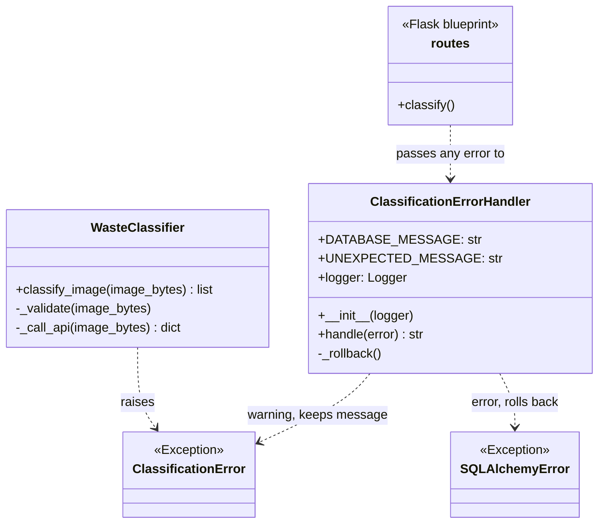

## Home Assignment 4: Exception Handling and Unit Tests – Waste Classification

**Student:** Swarbhanu Bandyopadhaya · **Student ID:** 7226982 · **Subsystem:** Waste Identification & Classification
**GitHub project:** https://github.com/b-ahmoo/CPC---AI-Waste-Classification-System

Every failure in the classification subsystem goes through one class. It writes the error to the log so developers can see what went wrong, and returns a short message for the page so users never see a crash or a stack trace.

Code: `app/subsystems/classification/errors.py` · Tests: `app/subsystems/classification/tests/test_error_handling.py` (10 tests)

### Error handling (`app/subsystems/classification/errors.py`)

`ClassificationError` is the subsystem's own exception, raised for problems that are expected and whose message is already fit to show a user: a file that is not a JPEG or PNG, an image over 10 MB, or an unreadable answer from the AI. Low-level network and API failures are caught where they happen and re-raised as `ClassificationError` with `raise ... from e`, which keeps the original exception in the log.

The route wraps its work in a single `try/except` and passes anything that escapes to the handler, rather than wrapping each operation separately:

```python
try:
    ...
except Exception as e:
    error, results = _error_handler.handle(e), None
```

`handle()` then decides by exception type:

| Error type | Logged as | Shown to the user |
|---|---|---|
| `ClassificationError` | warning | the error's own message |
| `SQLAlchemyError` | error, then session rollback | "The database is not available right now. Please try again later." |
| anything else | error with full traceback (`exc_info`) | "Something went wrong. Please try again." |

The rollback matters: a failed transaction left open makes every later query on that connection fail too, so one bad request would break the page until restart. `_rollback()` is itself wrapped in `try/except`, because the handler must not raise.

The recent-scans query at the bottom of the route has its own `handle()` call, so if the database is unavailable the page still renders with an empty list instead of failing completely.

### Unit tests (`app/subsystems/classification/tests/test_error_handling.py`)

10 tests, written with pytest and Flask's test client against an in-memory database (no MySQL or API key needed):

| Test | Checks |
|---|---|
| `test_handler_returns_message_of_classification_error` | an expected error keeps its own message |
| `test_handler_returns_database_message_for_database_error` | a database error becomes the generic database message |
| `test_handler_returns_generic_message_for_unexpected_error` | an unknown error becomes the generic message |
| `test_handler_writes_errors_to_the_log` | nothing is silently swallowed |
| `test_no_file_chosen_shows_message` | submitting with no file |
| `test_wrong_file_type_shows_message` | a file that is not JPEG or PNG |
| `test_image_over_10_mb_shows_message` | an oversized upload |
| `test_api_failure_shows_message` | the AI call failing |
| `test_database_down_during_upload_shows_message` | the database failing mid-upload |
| `test_page_still_loads_when_database_is_down` | the page renders even when recent scans cannot be read |

Run all classification tests (66, covering Home Assignments 1–4):
`docker compose run --rm web python -m pytest app/subsystems/classification/tests`


