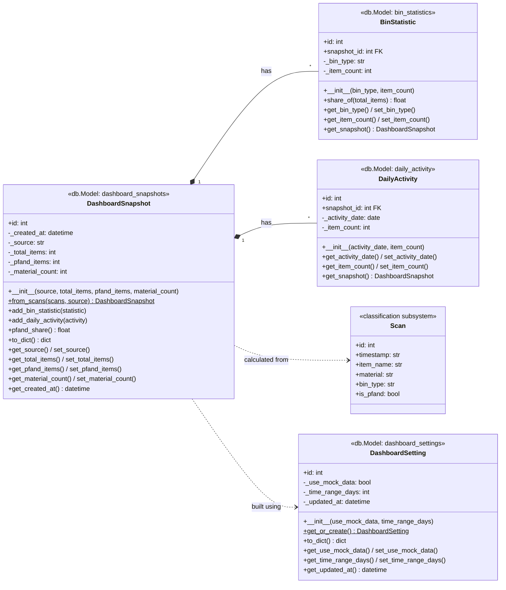

# CPC - AI Waste Classification System

An AI-driven application designed to assist users with waste classification and regional recycling guidelines using computer vision and conversational AI.

---

## Prerequisites

Before running the application, ensure you have the following installed on your machine:
- [Docker Desktop](https://www.docker.com/products/docker-desktop/) (ensure it is running with WSL 2 backend on Windows)
- [Git](https://git-scm.com/)

---

## Getting Started: Quickstart Guide

Follow these steps to get the project running locally without configuring a local Python environment.

### 1. Clone the Repository
```bash
git clone <YOUR_GITLAB_REPO_URL>
cd cpc-ai-waste-classification-system
```

### 2. Configure Environment Variables
Copy the template configuration file to create your local `.env` file.

**Windows (PowerShell):**
```powershell
Copy-Item .env.example .env
```

**Mac / Linux / Git Bash:**
```bash
cp .env.example .env
```

Open the `.env` file in your text editor and add your OpenAI API key and project secrets:
```env
OPENAI_API_KEY=your_actual_key_here
FLASK_DEBUG=1
```

### 3. Build and Start the Application
Run Docker Compose to build the image and launch the web server:
```bash
docker compose up --build
```

### 4. Access the Application
Open your web browser and navigate to: [http://localhost:8000](http://localhost:8000)

To stop the application, press `Ctrl + C` in your terminal, or run:
```bash
docker compose down
```

### 5. Access the Database
Open your web browser and navigate to: [http://localhost:8080](http://localhost:8080)
---

## Development Workflow & Subsystems

This project is divided into four modular subsystems:

* **User Creation & Management** (`app/subsystems/auth/`)
* **Waste Identification & Classification** (`app/subsystems/classification/`)
* **Educational Chatbot** (`app/subsystems/chatbot/`)
* **Statistical Dashboard** (`app/subsystems/dashboard/`)

---

## Branching Guidelines

* **Do not** commit directly to `main`.
* **Branch naming convention:** `feature/<subsystem>/<feature>` (e.g., `feature/educational/chatbot`).
* Once your task is complete and tested, push your branch and create a Merge Request (MR) on GitLab for review.

## Statistical Dashboard (Hiranmayai Nemani)

The Statistical Dashboard reads the classification results stored by the classification subsystem (the `scans` table), calculates statistics, and shows them on a web dashboard: summary cards (items classified, Pfand items, materials detected), an items-by-bin chart, and an activity-over-time chart. Each refresh is stored in the database as a snapshot.

Models: `app/models/dashboard.py` · Logic: `app/subsystems/dashboard/services.py` · Routes: `app/subsystems/dashboard/routes.py` · Page: `templates/dashboard/dashboard.html` · URL: http://localhost:8000/dashboard/

| Class (table) | Responsibility |
|---|---|
| `DashboardSetting` (`dashboard_settings`) | Where the dashboard gets its data: mock data or live scans, and how many days back. |
| `DashboardSnapshot` (`dashboard_snapshots`) | The statistics at one point in time: total items, Pfand items, number of materials. Built from scans with `from_scans()`. |
| `BinStatistic` (`bin_statistics`) | Items per bin type (e.g. Gelbe Tonne) in a snapshot, for the doughnut chart. |
| `DailyActivity` (`daily_activity`) | Items per day in a snapshot, for the line chart. |

All four are SQLAlchemy models (`db.Model` with `db.Column`), so `db.create_all()` creates their tables. Each has a constructor (`__init__`), initialization methods (`get_or_create`, `from_scans`, `add_bin_statistic`, `add_daily_activity`), and getters/setters that validate values before they are saved. A snapshot owns its `BinStatistic` and `DailyActivity` rows (one-to-many, deleted together).

Until the classifier has produced real scans, the dashboard uses mock scans generated with the classification subsystem's own bin rules (`rules.json`). Switch to live data with `POST /dashboard/api/settings` and `{"use_mock_data": false}`.




Run the tests: `docker compose exec web pytest app/subsystems/dashboard/tests`
