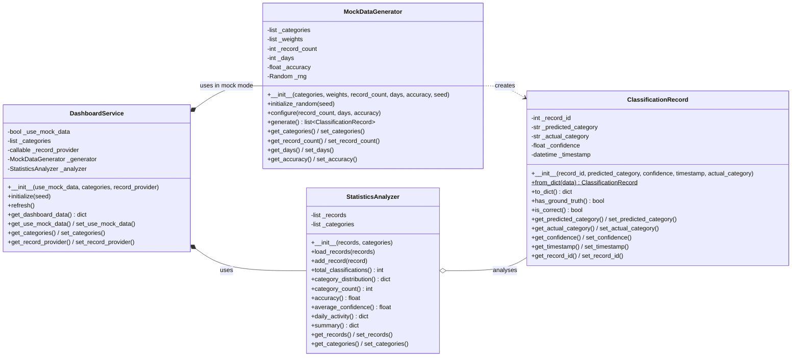
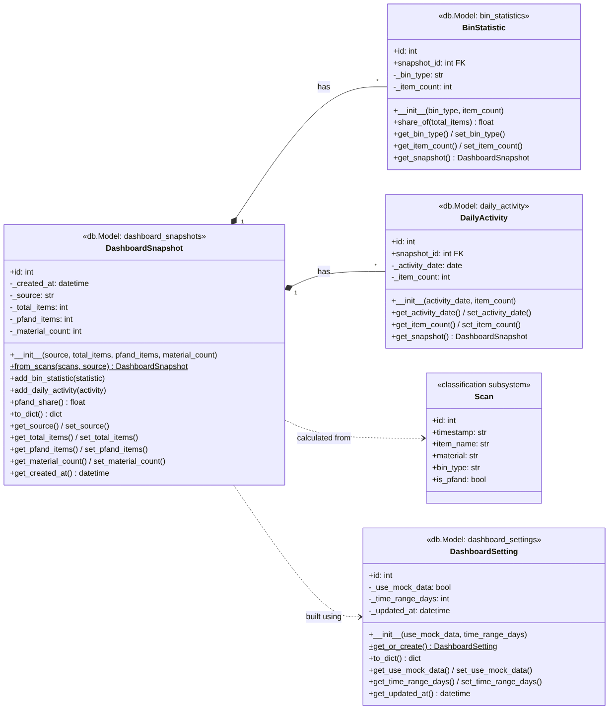

# CPC - AI Waste Classification System

An AI-driven application designed to assist users with waste classification and regional recycling guidelines using computer vision and conversational AI.

---

## Prerequisites

Before running the application, ensure you have the following installed on your machine:
- [Docker Desktop](https://www.docker.com/products/docker-desktop/) (ensure it is running with WSL 2 backend on Windows)
- [Git](https://git-scm.com/)

---

## Getting Started: Quickstart Guide

Follow these steps to get the project running locally without configuring a local Python environment.

### 1. Clone the Repository
```bash
git clone <YOUR_GITLAB_REPO_URL>
cd cpc-ai-waste-classification-system
```

### 2. Configure Environment Variables
Copy the template configuration file to create your local `.env` file.

**Windows (PowerShell):**
```powershell
Copy-Item .env.example .env
```

**Mac / Linux / Git Bash:**
```bash
cp .env.example .env
```

Open the `.env` file in your text editor and add your OpenAI API key and project secrets:
```env
OPENAI_API_KEY=your_actual_key_here
FLASK_DEBUG=1
```

### 3. Build and Start the Application
Run Docker Compose to build the image and launch the web server:
```bash
docker compose up --build
```

### 4. Access the Application
Open your web browser and navigate to: [http://localhost:8000](http://localhost:8000)

To stop the application, press `Ctrl + C` in your terminal, or run:
```bash
docker compose down
```

### 5. Access the Database
Open your web browser and navigate to: [http://localhost:8080](http://localhost:8080)
---

## Development Workflow & Subsystems

This project is divided into four modular subsystems:

* **User Creation & Management** (`app/subsystems/auth/`)
* **Waste Identification & Classification** (`app/subsystems/classification/`)
* **Educational Chatbot** (`app/subsystems/chatbot/`)
* **Statistical Dashboard** (`app/subsystems/dashboard/`)

---

## Branching Guidelines

* **Do not** commit directly to `main`.
* **Branch naming convention:** `feature/<subsystem>/<feature>` (e.g., `feature/educational/chatbot`).
* Once your task is complete and tested, push your branch and create a Merge Request (MR) on GitLab for review.

## Statistical Dashboard (Hiranmayai Nemani)

The Statistical Dashboard subsystem receives classification results, calculates statistics, and shows them on a web dashboard: summary cards, a waste-by-category chart, and an activity-over-time chart.

Code: `app/subsystems/dashboard/` · Page: `templates/dashboard/dashboard.html` · URL: http://localhost:8000/dashboard/

| Class | Responsibility |
|---|---|
| `ClassificationRecord` | One classification result: predicted category, actual category, confidence, timestamp. Validates its data in the setters. |
| `MockDataGenerator` | Creates realistic mock records while the classifier is still in development. Configurable count, time range, accuracy, and random seed. |
| `StatisticsAnalyzer` | Calculates total classifications, category distribution, accuracy, average confidence, and daily activity. |
| `DashboardService` | Chooses the data source (mock or live), uses the analyzer, and returns the data in the format the dashboard needs. |

Every class has a constructor (`__init__`), initialization methods (`from_dict`, `initialize_random`, `configure`, `load_records`, `initialize`), and getters/setters for its private attributes.

`routes.py` connects the subsystem to the web app: `/dashboard/` shows the page and `/dashboard/api/stats` returns the statistics as JSON.





Run the tests: `python -m unittest tests.test_dashboard`
