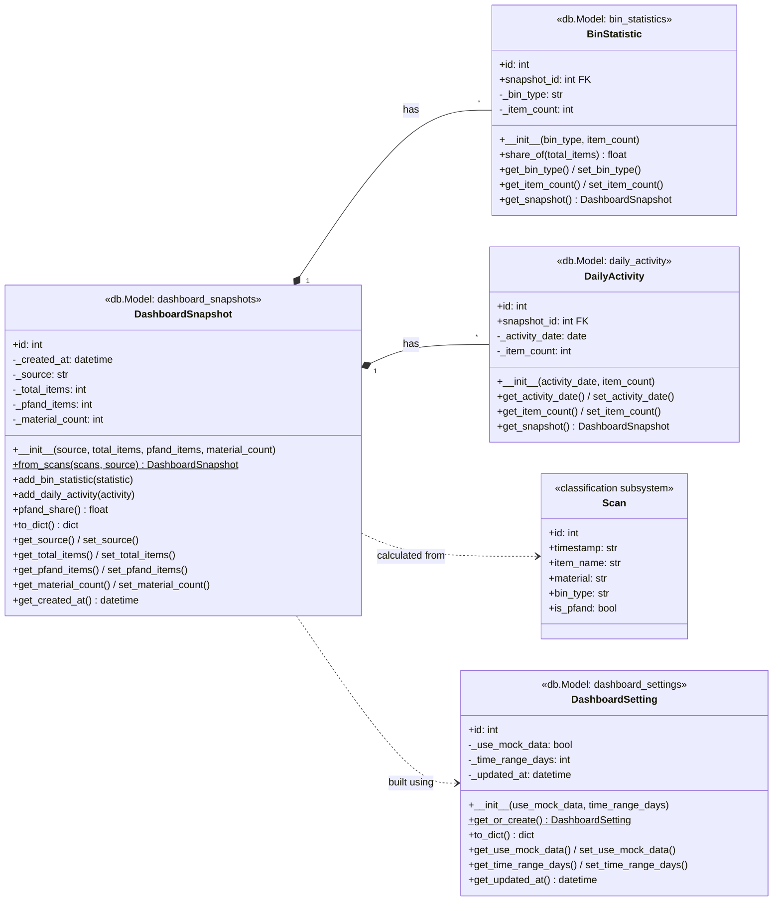
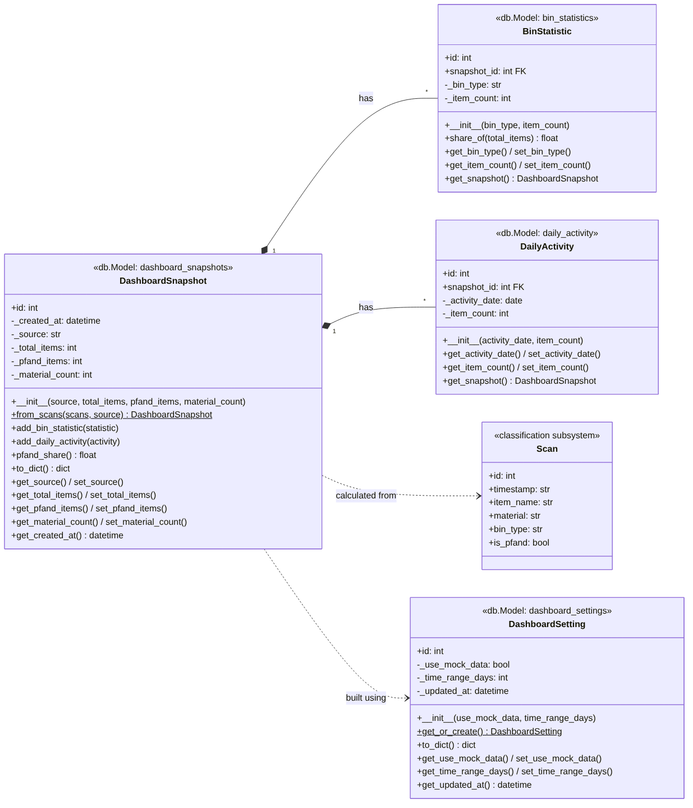
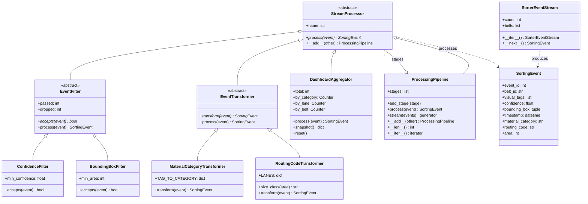
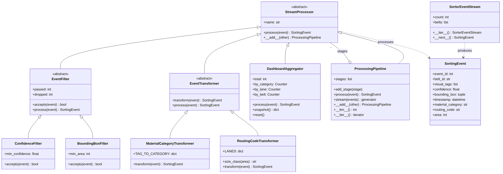

# CPC - AI Waste Classification System

An AI-driven application designed to assist users with waste classification and regional recycling guidelines using computer vision and conversational AI.

# MVP Features Documentation: AI Waste Classification System

This document outlines the Minimum Viable Product (MVP) features and database requirements for the four core subsystems of the AI Waste Classification project.

---
# Team members and assigned subsystems

* Ah-Moo Bhavisha (7226049) - Educational Chatbot
* Srivaishnavi Jakku (7225998) - Statistical Dashboard
* Swarbhanu Bandyopadhaya (7226982) - Classification System
* Sejal Dolas ( 7226366 ) - User Management
---
# Home Task Assignments
Link to video presentations for the home task assignments  can be found below. Access only with an FH-Dortmund account.

### Home Task Assignment 1
Branch: [hometaskassignment001](https://github.com/b-ahmoo/CPC---AI-Waste-Classification-System/tree/hometaskassignment001)  
Video:[Video HTA1](https://fhdoprod-my.sharepoint.com/:v:/r/personal/bhavisha_ah-moo001_stud_fh-dortmund_de/Documents/MDTSem1/CPC/Capstone/HomeTaskAssignment%20Videos/Group3_HomeTaskAssignment1.mp4?d=wd3aec5dd936c4e9a9eceb3ea7e8f70a9&csf=1&web=1&nav=eyJyZWZlcnJhbEluZm8iOnsicmVmZXJyYWxBcHAiOiJPbmVEcml2ZUZvckJ1c2luZXNzIiwicmVmZXJyYWxBcHBQbGF0Zm9ybSI6IldlYiIsInJlZmVycmFsTW9kZSI6InZpZXciLCJyZWZlcnJhbFZpZXciOiJNeUZpbGVzTGlua0NvcHkifX0&e=zaWQr1)

### Home Task Assignment 2
Branch: [HomeworkAssignment2](https://github.com/b-ahmoo/CPC---AI-Waste-Classification-System/tree/HomeworkAssignment2)  
Video: [Video HTA2](https://fhdoprod-my.sharepoint.com/:v:/r/personal/bhavisha_ah-moo001_stud_fh-dortmund_de/Documents/MDTSem1/CPC/Capstone/HomeTaskAssignment%20Videos/Group3_HomeTaskAssignment2.mp4?d=w5af3f756afcc456185820c3f00a66ad2&csf=1&web=1&nav=eyJyZWZlcnJhbEluZm8iOnsicmVmZXJyYWxBcHAiOiJPbmVEcml2ZUZvckJ1c2luZXNzIiwicmVmZXJyYWxBcHBQbGF0Zm9ybSI6IldlYiIsInJlZmVycmFsTW9kZSI6InZpZXciLCJyZWZlcnJhbFZpZXciOiJNeUZpbGVzTGlua0NvcHkifX0&e=xhRyno)  

### Home Task Assignment 3
Branch: [HomeworkAssignment3](https://github.com/b-ahmoo/CPC---AI-Waste-Classification-System/tree/HomeworkAssignment3)  
Video: [Video HTA3](https://fhdoprod-my.sharepoint.com/:v:/r/personal/bhavisha_ah-moo001_stud_fh-dortmund_de/Documents/MDTSem1/CPC/Capstone/HomeTaskAssignment%20Videos/Group3_HomeTaskAssignment3.mp4?d=wb52b4e0d50f942f9992fae9a38dc76f2&csf=1&web=1&nav=eyJyZWZlcnJhbEluZm8iOnsicmVmZXJyYWxBcHAiOiJPbmVEcml2ZUZvckJ1c2luZXNzIiwicmVmZXJyYWxBcHBQbGF0Zm9ybSI6IldlYiIsInJlZmVycmFsTW9kZSI6InZpZXciLCJyZWZlcnJhbFZpZXciOiJNeUZpbGVzTGlua0NvcHkifX0&e=SuuB52)  

### Home Task Assignment 4  
Branch: [HomeworkAssignment4](https://github.com/b-ahmoo/CPC---AI-Waste-Classification-System/tree/HomeworkAssignment4)  
Video: [Video HTA4](https://fhdoprod-my.sharepoint.com/:v:/g/personal/bhavisha_ah-moo001_stud_fh-dortmund_de/IQDA8MnjKNeJSrsNb25xY20kAXG93LjWu2JPMqxCra-rMcU?nav=eyJyZWZlcnJhbEluZm8iOnsicmVmZXJyYWxBcHAiOiJPbmVEcml2ZUZvckJ1c2luZXNzIiwicmVmZXJyYWxBcHBQbGF0Zm9ybSI6IldlYiIsInJlZmVycmFsTW9kZSI6InZpZXciLCJyZWZlcnJhbFZpZXciOiJNeUZpbGVzTGlua0NvcHkifX0&email=galyna.tabunshchyk%40fh-dortmund.de&e=ObBhz9)


# Class Diagrams
## 1. User Management Subsystem (Sejal Dolas)  
This module handles user creation and profile settings.

* **User creation:** Basic user creation and account setup.
* **Country selection upon set up** Must implement a minimum of 3 unique database entities.
* **Login:** User login and authentication after account creation.
* **View country specific rules:** Access a repository of local recycling rules based on selected country.


## 2. Waste Classification Subsystem (Swarbhanu Bandyopadhaya)  

This module handles the core computer vision and identification features.

* **Geographic Scope:** Provides basic waste classification supporting a maximum of 2 countries.
* **Data Persistence:** Every single item scanned must be saved to the database. 
  * *Example:* If a user scans 2 plastic bottles, it must create 2 separate entries in the database.


## 3. Educational Chatbot (Bhavisha Ah-Moo)  
This module provides conversational AI assistance for local recycling rules.

* **Core Functionality:** Basic Q&A capabilities focusing on waste disposal rules for 2 countries.
* **Session Handling:** Must include active chat session management.
* **Database Integration:** Must connect to the database to:
  * Fetch local recycling rules to feed as context to the chatbot.
  * Fetch the active user's selected country.
  * Fetch count of number of items scanned of a specific type of material.


## 4. Analytics Dashboard (Srivaishnavi Jakku)  
This module provides statistical insights based on classification data.

* **User Statistics:** Basic stats displaying the volume of items scanned per category for individual users. 
  * *Example:* "40% plastic scanned during the last week."
* **Government Statistics:** Basic statistical views tailored specifically for government officials and municipalities.
* **Database Integration:** Must connect to the database to fetch and filter information dynamically by selected fields.


---

# Setting up the project and Testing

## Prerequisites

Before running the application, ensure you have the following installed on your machine:
- [Docker Desktop](https://www.docker.com/products/docker-desktop/) (ensure it is running with WSL 2 backend on Windows)
- [Git](https://git-scm.com/)

---

## Getting Started: Quickstart Guide

Follow these steps to get the project running locally without configuring a local Python environment.

### 1. Clone the Repository
```bash
git clone <GITLAB_REPO_URL>
cd CPC---AI-Waste-Classification-System
```

### 2. Configure Environment Variables
Copy the template configuration file to create your local `.env` file.

**Windows (PowerShell):**
```powershell
Copy-Item .env.example .env
```

**Mac / Linux / Git Bash:**
```bash
cp .env.example .env
```

Open the `.env` file in your text editor and add your OpenAI API key and project secrets:
```env
FLASK_ENV=development
SECRET_KEY=replace-with-a-random-secret-key
AZURE_OPENAI_API_KEY=replace-with-your-open-ai-secret-key
AZURE_OPENAI_ENDPOINT=replace-with-your-open-ai-endpoint
AZURE_OPENAI_API_VERSION=replace-with-your-open-ai-version
AZURE_OPENAI_DEPLOYMENT_NAME=replace-with-your-deployment-name
MYSQL_USER=waste_user
MYSQL_PASSWORD=waste_password
MYSQL_DATABASE=waste_assistant_db
DATABASE_URL=mysql+pymysql://waste_user:waste_password@db:3306/waste_assistant_db
```

### 3. Build and Start the Application
Run Docker Compose to build the image and launch the web server:
```bash
docker compose up --build
```

### Note:

Make sure you are on the `main` branch when running the docker and testing the application. The `main` branch contains the completed system.

### 4. Access the Application
Open your web browser and navigate to: [http://localhost:8000](http://localhost:8000)

To stop the application, press `Ctrl + C` in your terminal, or run:
```bash
docker compose down
```

### 5. Access the Database  

Open your web browser and navigate to: [http://localhost:8080](http://localhost:8080)


### 6. Routes

The subsystems can be accessed and tested at the following routes:

* User management:
* Chatbot: [http://localhost:8000/chat](http://localhost:8000/chat)
* Classification: [http://localhost:8000/classify](http://localhost:8000/classify)
* Dashboard: [http://localhost:8000/dashboard](http://localhost:8000/dashboard)


---

# The following sections are intended for documentation purposes only.

The following sections document the project architecture, programming guidelines to follow and CI/CD pipelines to abide by. These sections are intended for members of the group working on the project but can be considered for understanding the architecture of the system.

## Branching Guidelines

* **Do not** commit directly to `main`.
* **Branch naming convention:** `feature/<subsystem>/<feature>` (e.g., `feature/chatbot/chatbot-setup`).
* Once your task is complete and tested, create a pull request and resolve any conflicts that may arise.
* Home task assignments have their own dedicated branches. Therefore in addition to merging your home task assignments on main, also merge in the respective branches.


## Database & Object-Oriented Architecture Guide

This section documents our team's database infrastructure, Object-Relational Mapping (ORM) setup, and the strict guidelines required for implementing Object-Oriented Programming (OOP) classes in each subsystem. Following these guidelines ensures your classes successfully generate MySQL tables and meet the assignment's explicit database integration rubric.

### 1. Technology Stack & Rationale
* **MySQL 8.0:** Acts as our core relational database. It provides a robust, persistent storage layer required to prove explicit database integration for the final submission.
* **phpMyAdmin:** A web-based graphical interface running alongside our containers. It allows team members to visually verify that their subsystem tables and data records are generating correctly without needing to write raw SQL queries in the terminal.
* **Flask-SQLAlchemy (ORM):** The Object-Relational Mapper bridges our Python OOP code with the MySQL database. It automatically translates Python class blueprints into MySQL tables. We use this to keep our codebase entirely in Python while satisfying the database integration requirement.

### 2. Class Implementation Guidelines for Team Members
To prevent critical bugs where subsystem tables fail to generate in MySQL, all team members must strictly distinguish between **Data Entities** and **Service Classes**. Our subsystem architectures rely heavily on Composition and Service Delegation, meaning these two types of classes are written differently.

#### A. Data Entities (Must use `db.Model`)
If your class represents data that needs to be permanently saved to the database (e.g., `ChatSession`, `WasteRule`, `ClassificationRecord`), **it must inherit from `db.Model`**.
* **State Initialization:** Do not write a traditional `__init__` constructor. SQLAlchemy generates this automatically. Instead, define your state variables as `db.Column` attributes.
* **Encapsulation:** To satisfy the assignment rubric, you must manually write explicit Getters and Setters (e.g., `get_confidence(self)`, `set_confidence(self, value)`) for every column attribute.

**Example Data Entity Structure:**
```python
from app.extensions import db

class ClassificationRecord(db.Model):
    __tablename__ = 'classification_records'

    # 1. State Initialization (Database Columns)
    record_id = db.Column(db.Integer, primary_key=True, autoincrement=True)
    confidence = db.Column(db.Float, nullable=False, default=0.0)

    # 2. Encapsulation
    def get_record_id(self):
        return self.record_id

    def set_record_id(self, record_id):
        self.record_id = record_id
        
    def get_confidence(self):
        return self.confidence

    def set_confidence(self, confidence):
        self.confidence = float(confidence)
```

#### B. Service Classes (Standard Python Classes)
If your class handles business logic, processing, or acts as a middleman (e.g., `ChatbotService`), it does not belong in the database.
* **Do not** inherit from `db.Model`.
* **Do** write a traditional `def __init__(self):` constructor to initialize state.
* **Do** write explicit Getters and Setters for its internal variables.

### 3. Registering Your Classes to Generate Tables
SQLAlchemy's `db.create_all()` command executes exactly once during the Flask app initialization. It does not automatically scan the project folder for new files. **If your class is not explicitly imported before this command runs, your MySQL table will not be created.**

**How to register your subsystem models:**
1. Open the centralized application factory file: `app/__init__.py`.
2. Locate the `with app.app_context():` block.
3. Import your specific model directly into this block *before* the `db.create_all()` execution.

```python
    with app.app_context():
        # Import your subsystem models here so SQLAlchemy detects them
        from app.models.chatbot import ChatSession, ChatMessage, WasteRule
        from app.models.dashboard import ClassificationRecord
        
        # Generates all detected models into MySQL tables
        db.create_all()
```

### 4. Troubleshooting Table Generation
If you navigate to phpMyAdmin and do not see your new tables, verify the following steps:
1. **Check your class definition:** Ensure your class inherits from `(db.Model)` and uses `db.Column`. Regular Python classes exist only in temporary memory and will never generate a MySQL table.
2. **Check your imports:** Ensure your file is explicitly imported inside the `app.app_context()` block in `app/__init__.py`.
3. **Rebuild the Container:** The database generation command only runs on startup. If you add a new model, you must completely restart the Docker environment for it to take effect. Run the following commands in your terminal:

```bash
docker compose down
docker compose up --build
```

## Statistical Dashboard (Srivaishnavi Jakku)

The Statistical Dashboard reads the classification results stored by the classification subsystem (the `scans` table), calculates statistics, and shows them on a web dashboard: summary cards (items classified, Pfand items, materials detected), an items-by-bin chart, and an activity-over-time chart. Each refresh is stored in the database as a snapshot.

Models: `app/models/dashboard.py` · Logic: `app/subsystems/dashboard/services.py` · Routes: `app/subsystems/dashboard/routes.py` · Page: `templates/dashboard/dashboard.html` · URL: http://localhost:8000/dashboard/

| Class (table) | Responsibility |
|---|---|
| `DashboardSetting` (`dashboard_settings`) | Where the dashboard gets its data: mock data or live scans, and how many days back. |
| `DashboardSnapshot` (`dashboard_snapshots`) | The statistics at one point in time: total items, Pfand items, number of materials. Built from scans with `from_scans()`. |
| `BinStatistic` (`bin_statistics`) | Items per bin type (e.g. Gelbe Tonne) in a snapshot, for the doughnut chart. |
| `DailyActivity` (`daily_activity`) | Items per day in a snapshot, for the line chart. |

All four are SQLAlchemy models (`db.Model` with `db.Column`), so `db.create_all()` creates their tables. Each has a constructor (`__init__`), initialization methods (`get_or_create`, `from_scans`, `add_bin_statistic`, `add_daily_activity`), and getters/setters that validate values before they are saved. A snapshot owns its `BinStatistic` and `DailyActivity` rows (one-to-many, deleted together).

Until the classifier has produced real scans, the dashboard uses mock scans generated with the classification subsystem's own bin rules (`rules.json`). Switch to live data with `POST /dashboard/api/settings` and `{"use_mock_data": false}`.





Run the tests: `docker compose exec web python -m pytest app/subsystems/dashboard/tests`

## Home Assignment 2: Statistical Dashboard Stream Processing (Srivaishnavi Jakku)

Scenario: **AI-Powered Waste Sorting & Recycling Assistant.** Optical sorters on the conveyor belts send a continuous stream of image-recognition payloads. The dashboard's pipeline filters out low-confidence predictions and tiny noise detections, transforms visual tags and bounding boxes into material categories (PET, HDPE, Aluminium, ...) and conveyor routing codes (e.g. `L1-PET-M`), and aggregates the stream into live dashboard statistics.

Code: `app/subsystems/dashboard/stream.py` · Tests: `app/subsystems/dashboard/tests/test_stream.py`

| OOP concept | Where |
|---|---|
| Abstract Base Classes | `StreamProcessor` (`process`), `EventFilter` (`accepts`), `EventTransformer` (`transform`), all with `@abstractmethod` |
| Inheritance & polymorphism | `ConfidenceFilter`, `BoundingBoxFilter`, `MaterialCategoryTransformer`, `RoutingCodeTransformer`, `DashboardAggregator`: every stage is called through the same `process()` |
| Operator overloading | `__add__`: `ConfidenceFilter() + BoundingBoxFilter() + MaterialCategoryTransformer()` builds a `ProcessingPipeline` |
| Iterators & generators | `SorterEventStream` implements `__iter__`/`__next__`; `ProcessingPipeline.stream()` and `tumbling_windows()` are generators |

```python
pipeline = (ConfidenceFilter(0.75) + BoundingBoxFilter(400)
            + MaterialCategoryTransformer() + RoutingCodeTransformer() + DashboardAggregator())
for window in tumbling_windows(pipeline.stream(SorterEventStream(count=200)), 25):
    ...  # refresh the dashboard once per window
```

### Class diagram





Run the demo: `docker compose exec web python app/subsystems/dashboard/stream.py`
Run the tests: `docker compose exec web python -m pytest app/subsystems/dashboard/tests`

### Video

Video presentation: _link to be added_

## Home Assignment 3: Flask + MySQL Data Output – Statistical Dashboard

**Student:** Srivaishnavi Jakku · **Student ID:** 7225998 · **Subsystem:** Statistical Dashboard
**GitHub project:** https://github.com/b-ahmoo/CPC---AI-Waste-Classification-System

The Statistical Dashboard is a Flask blueprint (`app/subsystems/dashboard`) that uses the project's shared MySQL database through Flask-SQLAlchemy. It reads the classification results stored in the `scans` table, calculates statistics, stores them in its own tables, and outputs the data on two pages.

| Page | URL | What it shows |
|---|---|---|
| Overview | http://localhost:8000/dashboard/ | Summary cards (items classified, Pfand items, materials detected), items-by-bin chart, activity-over-time chart |
| Data | http://localhost:8000/dashboard/data | The rows of the `scans` table, filterable by material, bin and time period, plus the latest saved snapshots from `dashboard_snapshots` |

**MySQL tables used**

| Table | Model | Role |
|---|---|---|
| `scans` | `Scan` (classification subsystem) | Source data: one row per classified item |
| `dashboard_settings` | `DashboardSetting` | Mock or live data, time range |
| `dashboard_snapshots` | `DashboardSnapshot` | Statistics saved on every Overview visit |
| `bin_statistics` | `BinStatistic` | Items per bin in a snapshot |
| `daily_activity` | `DailyActivity` | Items per day in a snapshot |

**How it works:** `routes.py` handles the requests, `services.py` queries MySQL with SQLAlchemy (e.g. `Scan.query.filter(Scan.material == material).order_by(Scan.timestamp.desc())`), and the Jinja templates in `templates/dashboard/` render the results as HTML tables and charts.

**Run it**

1. Copy `.env.example` to `.env` and set the MySQL settings (`MYSQL_DATABASE`, `MYSQL_USER`, `MYSQL_PASSWORD`, `DATABASE_URL=mysql+pymysql://<user>:<password>@db:3306/<database>`).
2. `docker compose up --build`
3. Open http://localhost:8000/dashboard/data and click **Add sample scans** to fill the `scans` table with example rows (they can be removed again with **Remove sample scans**).
4. Check the tables in phpMyAdmin: http://localhost:8080
5. Tests: `docker compose exec web python -m pytest app/subsystems/dashboard/tests`

## Home Assignment 4: Exception Handling and Unit Tests – Statistical Dashboard

**Student:** Srivaishnavi Jakku · **Student ID:** 7225998 · **Subsystem:** Statistical Dashboard
**GitHub project:** https://github.com/b-ahmoo/CPC---AI-Waste-Classification-System

### Error handling (`app/subsystems/dashboard/errors.py`)

The dashboard raises its own exceptions, each with an HTTP status and a message that is safe to show to users:

| Exception | Status | Raised when |
|---|---|---|
| `DashboardError` | 500 | Base class for every dashboard error |
| `InvalidSettingError` | 400 | A setting is invalid, unknown, or the request body is not JSON |
| `InvalidFilterError` | 400 | A filter such as `?days=` is not a whole number between 1 and 365 |
| `DataSourceError` | 503 | The scans, the bin rules or the dashboard tables cannot be read or saved |

**`DashboardErrorHandler`** is the subsystem's error-handling class. Every dashboard route uses it:

* it maps any exception to a `DashboardError` (`ValueError` from the model setters → 400, `SQLAlchemyError` → 503, anything else → 500),
* logs user mistakes as warnings and real bugs with the full traceback,
* rolls back a failed database transaction (and logs it if the rollback itself fails),
* returns a consistent JSON body, e.g. `{"error": "days must be a whole number.", "type": "InvalidFilterError", "field": "days"}`, so users never see a stack trace,
* registers itself on the blueprint, so 404/405 errors under `/dashboard` are also returned as JSON,
* on the HTML data page, errors are shown as a message on the page instead of JSON.

The services use `try / except / else / finally` and exception chaining (`raise DataSourceError(...) from error`), skip scans with unreadable timestamps instead of failing, and settings changes are rolled back completely if any value is invalid.

### Unit tests (`app/subsystems/dashboard/tests/test_error_handling.py`)

22 tests, written with pytest and Flask's test client against an in-memory database (no MySQL or API key needed):

| Area | Tests |
|---|---|
| Exception classes | hierarchy and status codes; default messages and `field` |
| `DashboardErrorHandler` | `ValueError` → 400; database error → 503 with rollback; unexpected errors hidden from users but logged with traceback; user mistakes logged as warnings; failed rollback logged, not raised |
| Services | valid `days` values; invalid `days` values; missing rules file → `DataSourceError` with the original cause; scans with broken timestamps skipped |
| Routes | invalid `?days=` → 400; database down → 503; failed snapshot save → 503 and nothing saved; non-JSON settings body → 400; unknown setting → 400; invalid setting rolled back completely; unknown dashboard URL → JSON 404; wrong HTTP method → JSON 405; unexpected bug → friendly 500; data page with invalid filter → 400 with message; data page with database down → 503 with message |

Run all dashboard tests (77, covering Home Assignments 1–4):
`docker compose exec web python -m pytest app/subsystems/dashboard/tests`
