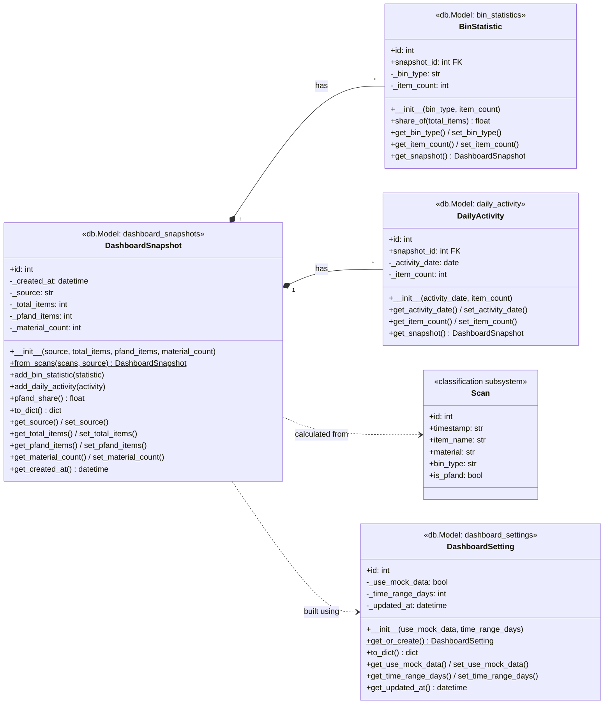
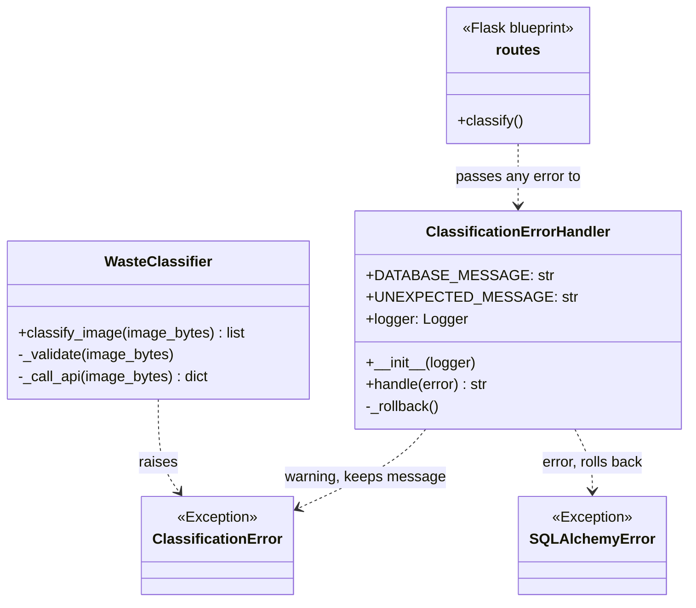

# CPC - AI Waste Classification System

An AI-driven application designed to assist users with waste classification and regional recycling guidelines using computer vision and conversational AI.

# MVP Features Documentation: AI Waste Classification System

This document outlines the Minimum Viable Product (MVP) features and database requirements for the four core subsystems of the AI Waste Classification project.

---
# Team members and assigned subsystems

* Ah-Moo Bhavisha (7226049) - Educational Chatbot
* Srivaishnavi Jakku (7225998) - Statistical Dashboard
* Swarbhanu Bandyopadhaya (7226982) - Classification System
* Sejal Dolas ( 7226366 ) - User Management

## Link to video presentation for HomeTaskAssignment001 can be found below. Access only with an FH-Dortmund account.
https://fhdoprod-my.sharepoint.com/:v:/g/personal/bhavisha_ah-moo001_stud_fh-dortmund_de/IQBIXyuMsSihTLkcpW2DtQS7AaTGcqT9h8J7gA8K9ogRa9I?nav=eyJyZWZlcnJhbEluZm8iOnsicmVmZXJyYWxBcHAiOiJPbmVEcml2ZUZvckJ1c2luZXNzIiwicmVmZXJyYWxBcHBQbGF0Zm9ybSI6IldlYiIsInJlZmVycmFsTW9kZSI6InZpZXciLCJyZWZlcnJhbFZpZXciOiJNeUZpbGVzTGlua0NvcHkifX0&e=ws5Ejz

All cod implementation of classes can be found under the branch hometaskassignment001 in this github repository, under app/models

# Class Diagrams
## 1. User Management Subsystem


## 2. Waste Classification Subsystem


## 3. Educational Chatbot


## 4. Analytics Dashboard


## 1. Waste Classification Subsystem
This module handles the core computer vision and identification features.

* **Geographic Scope:** Provides basic waste classification supporting a maximum of 2 countries.
* **Data Persistence:** Every single item scanned must be saved to the database. 
  * *Example:* If a user scans 2 plastic bottles, it must create 2 separate entries in the database.

## 2. User Management Subsystem
This module handles user creation and profile settings.

* **User creation:** Basic user creation and account setup.
* **Country selection upon set up** Must implement a minimum of 3 unique database entities.
* **Login:** User login and authentication after account creation.
* **View country specific rules:** Access a repository of local recycling rules based on selected country.


## 3. Analytics Dashboard
This module provides statistical insights based on classification data.

* **User Statistics:** Basic stats displaying the volume of items scanned per category for individual users. 
  * *Example:* "40% plastic scanned during the last week."
* **Government Statistics:** Basic statistical views tailored specifically for government officials and municipalities.
* **Database Integration:** Must connect to the database to fetch and filter information dynamically by selected fields.

## 4. Educational Chatbot
This module provides conversational AI assistance for local recycling rules.

* **Core Functionality:** Basic Q&A capabilities focusing on waste disposal rules for 2 countries.
* **Session Handling:** Must include active chat session management.
* **Database Integration:** Must connect to the database to:
  * Fetch local recycling rules to feed as context to the chatbot.
  * Fetch the active user's selected country.
* **Explicit Database Entities:** This subsystem requires these specific entities:
  * `chat session`
  * `chat message`
  * `waste rules`

---
*Note: All subsystems must strictly follow these MVP guidelines to meet the project's foundational database and feature requirements.*
---

## Database & Object-Oriented Architecture Guide

This section documents our team's database infrastructure, Object-Relational Mapping (ORM) setup, and the strict guidelines required for implementing Object-Oriented Programming (OOP) classes in each subsystem. Following these guidelines ensures your classes successfully generate MySQL tables and meet the assignment's explicit database integration rubric.

### 1. Technology Stack & Rationale
* **MySQL 8.0:** Acts as our core relational database. It provides a robust, persistent storage layer required to prove explicit database integration for the final submission.
* **phpMyAdmin:** A web-based graphical interface running alongside our containers. It allows team members to visually verify that their subsystem tables and data records are generating correctly without needing to write raw SQL queries in the terminal.
* **Flask-SQLAlchemy (ORM):** The Object-Relational Mapper bridges our Python OOP code with the MySQL database. It automatically translates Python class blueprints into MySQL tables. We use this to keep our codebase entirely in Python while satisfying the database integration requirement.

### 2. Class Implementation Guidelines for Team Members
To prevent critical bugs where subsystem tables fail to generate in MySQL, all team members must strictly distinguish between **Data Entities** and **Service Classes**. Our subsystem architectures rely heavily on Composition and Service Delegation, meaning these two types of classes are written differently.

#### A. Data Entities (Must use `db.Model`)
If your class represents data that needs to be permanently saved to the database (e.g., `ChatSession`, `WasteRule`, `ClassificationRecord`), **it must inherit from `db.Model`**.
* **State Initialization:** Do not write a traditional `__init__` constructor. SQLAlchemy generates this automatically. Instead, define your state variables as `db.Column` attributes.
* **Encapsulation:** To satisfy the assignment rubric, you must manually write explicit Getters and Setters (e.g., `get_confidence(self)`, `set_confidence(self, value)`) for every column attribute.

**Example Data Entity Structure:**
```python
from app.extensions import db

class ClassificationRecord(db.Model):
    __tablename__ = 'classification_records'

    # 1. State Initialization (Database Columns)
    record_id = db.Column(db.Integer, primary_key=True, autoincrement=True)
    confidence = db.Column(db.Float, nullable=False, default=0.0)

    # 2. Encapsulation
    def get_record_id(self):
        return self.record_id

    def set_record_id(self, record_id):
        self.record_id = record_id
        
    def get_confidence(self):
        return self.confidence

    def set_confidence(self, confidence):
        self.confidence = float(confidence)
```

#### B. Service Classes (Standard Python Classes)
If your class handles business logic, processing, or acts as a middleman (e.g., `ChatbotService`), it does not belong in the database.
* **Do not** inherit from `db.Model`.
* **Do** write a traditional `def __init__(self):` constructor to initialize state.
* **Do** write explicit Getters and Setters for its internal variables.

### 3. Registering Your Classes to Generate Tables
SQLAlchemy's `db.create_all()` command executes exactly once during the Flask app initialization. It does not automatically scan the project folder for new files. **If your class is not explicitly imported before this command runs, your MySQL table will not be created.**

**How to register your subsystem models:**
1. Open the centralized application factory file: `app/__init__.py`.
2. Locate the `with app.app_context():` block.
3. Import your specific model directly into this block *before* the `db.create_all()` execution.

```python
    with app.app_context():
        # Import your subsystem models here so SQLAlchemy detects them
        from app.models.chatbot import ChatSession, ChatMessage, WasteRule
        from app.models.dashboard import ClassificationRecord
        
        # Generates all detected models into MySQL tables
        db.create_all()
```

### 4. Troubleshooting Table Generation
If you navigate to phpMyAdmin and do not see your new tables, verify the following steps:
1. **Check your class definition:** Ensure your class inherits from `(db.Model)` and uses `db.Column`. Regular Python classes exist only in temporary memory and will never generate a MySQL table.
2. **Check your imports:** Ensure your file is explicitly imported inside the `app.app_context()` block in `app/__init__.py`.
3. **Rebuild the Container:** The database generation command only runs on startup. If you add a new model, you must completely restart the Docker environment for it to take effect. Run the following commands in your terminal:

```bash
docker compose down
docker compose up --build
```

## Prerequisites

Before running the application, ensure you have the following installed on your machine:
- [Docker Desktop](https://www.docker.com/products/docker-desktop/) (ensure it is running with WSL 2 backend on Windows)
- [Git](https://git-scm.com/)

---

## Getting Started: Quickstart Guide

Follow these steps to get the project running locally without configuring a local Python environment.

### 1. Clone the Repository
```bash
git clone <YOUR_GITLAB_REPO_URL>
cd cpc-ai-waste-classification-system
```

### 2. Configure Environment Variables
Copy the template configuration file to create your local `.env` file.

**Windows (PowerShell):**
```powershell
Copy-Item .env.example .env
```

**Mac / Linux / Git Bash:**
```bash
cp .env.example .env
```

Open the `.env` file in your text editor and add your OpenAI API key and project secrets:
```env
OPENAI_API_KEY=your_actual_key_here
FLASK_DEBUG=1
```

### 3. Build and Start the Application
Run Docker Compose to build the image and launch the web server:
```bash
docker compose up --build
```

### 4. Access the Application
Open your web browser and navigate to: [http://localhost:8000](http://localhost:8000)

To stop the application, press `Ctrl + C` in your terminal, or run:
```bash
docker compose down
```

### 5. Access the Database
Open your web browser and navigate to: [http://localhost:8080](http://localhost:8080)
---

## Development Workflow & Subsystems

This project is divided into four modular subsystems:

* **User Creation & Management** (`app/subsystems/auth/`)
* **Waste Identification & Classification** (`app/subsystems/classification/`)
* **Educational Chatbot** (`app/subsystems/chatbot/`)
* **Statistical Dashboard** (`app/subsystems/dashboard/`)

---

## Branching Guidelines

* **Do not** commit directly to `main`.
* **Branch naming convention:** `feature/<subsystem>/<feature>` (e.g., `feature/educational/chatbot`).
* Once your task is complete and tested, push your branch and create a Merge Request (MR) on GitLab for review.

## Statistical Dashboard (Srivaishnavi Jakku)

The Statistical Dashboard reads the classification results stored by the classification subsystem (the `scans` table), calculates statistics, and shows them on a web dashboard: summary cards (items classified, Pfand items, materials detected), an items-by-bin chart, and an activity-over-time chart. Each refresh is stored in the database as a snapshot.

Models: `app/models/dashboard.py` · Logic: `app/subsystems/dashboard/services.py` · Routes: `app/subsystems/dashboard/routes.py` · Page: `templates/dashboard/dashboard.html` · URL: http://localhost:8000/dashboard/

| Class (table) | Responsibility |
|---|---|
| `DashboardSetting` (`dashboard_settings`) | Where the dashboard gets its data: mock data or live scans, and how many days back. |
| `DashboardSnapshot` (`dashboard_snapshots`) | The statistics at one point in time: total items, Pfand items, number of materials. Built from scans with `from_scans()`. |
| `BinStatistic` (`bin_statistics`) | Items per bin type (e.g. Gelbe Tonne) in a snapshot, for the doughnut chart. |
| `DailyActivity` (`daily_activity`) | Items per day in a snapshot, for the line chart. |

All four are SQLAlchemy models (`db.Model` with `db.Column`), so `db.create_all()` creates their tables. Each has a constructor (`__init__`), initialization methods (`get_or_create`, `from_scans`, `add_bin_statistic`, `add_daily_activity`), and getters/setters that validate values before they are saved. A snapshot owns its `BinStatistic` and `DailyActivity` rows (one-to-many, deleted together).

Until the classifier has produced real scans, the dashboard uses mock scans generated with the classification subsystem's own bin rules (`rules.json`). Switch to live data with `POST /dashboard/api/settings` and `{"use_mock_data": false}`.




Run the tests: `docker compose exec web python -m pytest app/subsystems/dashboard/tests`


## Home Assignment 4: Exception Handling and Unit Tests – Statistical Dashboard

**Student:** Srivaishnavi Jakku · **Student ID:** 7225998 · **Subsystem:** Statistical Dashboard
**GitHub project:** https://github.com/b-ahmoo/CPC---AI-Waste-Classification-System

### Error handling (`app/subsystems/dashboard/errors.py`)

The dashboard raises its own exceptions, each with an HTTP status and a message that is safe to show to users:

| Exception | Status | Raised when |
|---|---|---|
| `DashboardError` | 500 | Base class for every dashboard error |
| `InvalidSettingError` | 400 | A setting is invalid, unknown, or the request body is not JSON |
| `InvalidFilterError` | 400 | A filter such as `?days=` is not a whole number between 1 and 365 |
| `DataSourceError` | 503 | The scans, the bin rules or the dashboard tables cannot be read or saved |

**`DashboardErrorHandler`** is the subsystem's error-handling class. Every dashboard route uses it:

* it maps any exception to a `DashboardError` (`ValueError` from the model setters → 400, `SQLAlchemyError` → 503, anything else → 500),
* logs user mistakes as warnings and real bugs with the full traceback,
* rolls back a failed database transaction (and logs it if the rollback itself fails),
* returns a consistent JSON body, e.g. `{"error": "days must be a whole number.", "type": "InvalidFilterError", "field": "days"}`, so users never see a stack trace,
* registers itself on the blueprint, so 404/405 errors under `/dashboard` are also returned as JSON.

The services use `try / except / else / finally` and exception chaining (`raise DataSourceError(...) from error`), skip scans with unreadable timestamps instead of failing, and settings changes are rolled back completely if any value is invalid.

### Unit tests (`app/subsystems/dashboard/tests/test_error_handling.py`)

20 tests, written with pytest and Flask's test client against an in-memory database (no MySQL or API key needed):

| Area | Tests |
|---|---|
| Exception classes | hierarchy and status codes; default messages and `field` |
| `DashboardErrorHandler` | `ValueError` → 400; database error → 503 with rollback; unexpected errors hidden from users but logged with traceback; user mistakes logged as warnings; failed rollback logged, not raised |
| Services | valid `days` values; invalid `days` values; missing rules file → `DataSourceError` with the original cause; scans with broken timestamps skipped |
| Routes | invalid `?days=` → 400; database down → 503; failed snapshot save → 503 and nothing saved; non-JSON settings body → 400; unknown setting → 400; invalid setting rolled back completely; unknown dashboard URL → JSON 404; wrong HTTP method → JSON 405; unexpected bug → friendly 500 |

Run all dashboard tests (34, including the Home Assignment 1 tests):
`docker compose exec web python -m pytest app/subsystems/dashboard/tests`

## Home Assignment 4: Exception Handling and Unit Tests – Waste Classification

**Student:** Swarbhanu Bandyopadhaya · **Student ID:** 7226982 · **Subsystem:** Waste Identification & Classification
**GitHub project:** https://github.com/b-ahmoo/CPC---AI-Waste-Classification-System

Every failure in the classification subsystem goes through one class. It writes the error to the log so developers can see what went wrong, and returns a short message for the page so users never see a crash or a stack trace.

Code: `app/subsystems/classification/errors.py` · Tests: `app/subsystems/classification/tests/test_error_handling.py` (10 tests)

### Error handling (`app/subsystems/classification/errors.py`)

`ClassificationError` is the subsystem's own exception, raised for problems that are expected and whose message is already fit to show a user: a file that is not a JPEG or PNG, an image over 10 MB, or an unreadable answer from the AI. Low-level network and API failures are caught where they happen and re-raised as `ClassificationError` with `raise ... from e`, which keeps the original exception in the log.

The route wraps its work in a single `try/except` and passes anything that escapes to the handler, rather than wrapping each operation separately:

```python
try:
    ...
except Exception as e:
    error, results = _error_handler.handle(e), None
```

`handle()` then decides by exception type:

| Error type | Logged as | Shown to the user |
|---|---|---|
| `ClassificationError` | warning | the error's own message |
| `SQLAlchemyError` | error, then session rollback | "The database is not available right now. Please try again later." |
| anything else | error with full traceback (`exc_info`) | "Something went wrong. Please try again." |

The rollback matters: a failed transaction left open makes every later query on that connection fail too, so one bad request would break the page until restart. `_rollback()` is itself wrapped in `try/except`, because the handler must not raise.

The recent-scans query at the bottom of the route has its own `handle()` call, so if the database is unavailable the page still renders with an empty list instead of failing completely.

### Unit tests (`app/subsystems/classification/tests/test_error_handling.py`)

10 tests, written with pytest and Flask's test client against an in-memory database (no MySQL or API key needed):

| Test | Checks |
|---|---|
| `test_handler_returns_message_of_classification_error` | an expected error keeps its own message |
| `test_handler_returns_database_message_for_database_error` | a database error becomes the generic database message |
| `test_handler_returns_generic_message_for_unexpected_error` | an unknown error becomes the generic message |
| `test_handler_writes_errors_to_the_log` | nothing is silently swallowed |
| `test_no_file_chosen_shows_message` | submitting with no file |
| `test_wrong_file_type_shows_message` | a file that is not JPEG or PNG |
| `test_image_over_10_mb_shows_message` | an oversized upload |
| `test_api_failure_shows_message` | the AI call failing |
| `test_database_down_during_upload_shows_message` | the database failing mid-upload |
| `test_page_still_loads_when_database_is_down` | the page renders even when recent scans cannot be read |

Run all classification tests (66, covering Home Assignments 1–4):
`docker compose run --rm web python -m pytest app/subsystems/classification/tests`



### Video

Video presentation: [Video HTA4](https://fhdoprod-my.sharepoint.com/:v:/g/personal/bhavisha_ah-moo001_stud_fh-dortmund_de/IQDA8MnjKNeJSrsNb25xY20kAXG93LjWu2JPMqxCra-rMcU?nav=eyJyZWZlcnJhbEluZm8iOnsicmVmZXJyYWxBcHAiOiJPbmVEcml2ZUZvckJ1c2luZXNzIiwicmVmZXJyYWxBcHBQbGF0Zm9ybSI6IldlYiIsInJlZmVycmFsTW9kZSI6InZpZXciLCJyZWZlcnJhbFZpZXciOiJNeUZpbGVzTGlua0NvcHkifX0&email=galyna.tabunshchyk%40fh-dortmund.de&e=ObBhz9)
